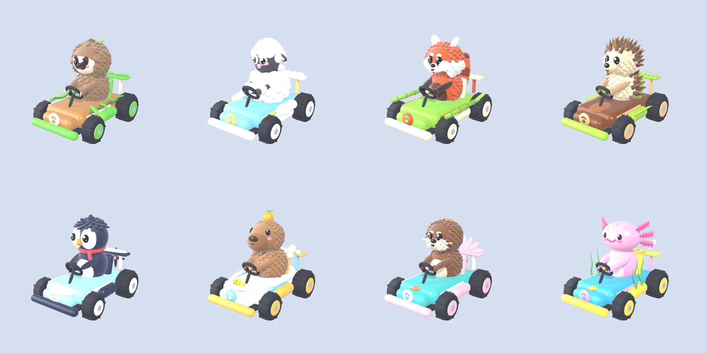
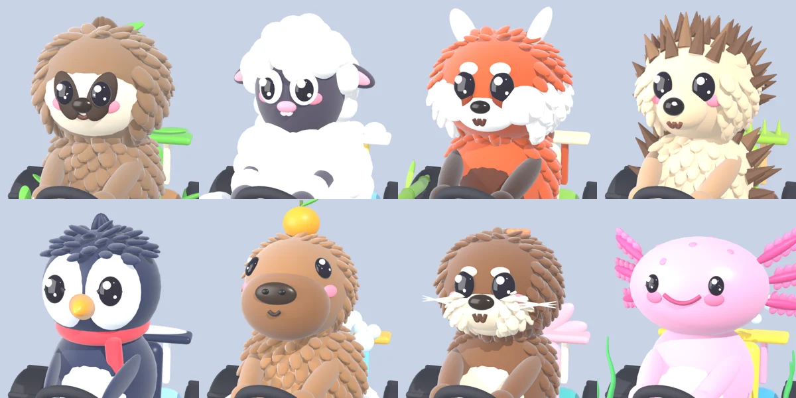

# 🐾 Trapanotto Kart

Ein flauschiges Kart-Rennspiel mit süssen Tieren, das direkt im Browser läuft.

**▶ Spielen: https://trapanotto.github.io/kart/**



## Fahrer

| Tier | Name | Stärke |
|---|---|---|
| Faultier | Fauli | Bestes Handling |
| Schaf | Wolke | Beste Beschleunigung |
| Rotpanda | Rubi | Stärkster Drift-Boost |
| Igel | Stupsi | Kaum zu erschüttern |
| Pinguin | Pingo | Voller Grip auf Eis |
| Capybara | Kapi | Höchstgeschwindigkeit |
| Otter | Otti | Ausgeglichen |
| Axolotl | Axi | Schnell wieder auf den Beinen |



## Inhalt

- **Modi:** Grand Prix (2 Cups mit je 4 Rennen, Punktewertung, Qualifikation ab Platz 4, Pokale), Einzelrennen, Versus (2–4 Spieler ohne Computer, Siegzählung), Zeitfahren mit Geist und Gold-/Silber-/Bronze-Zeiten
- **Freischaltbar:** Spiegel-Modus (Gold in allen Cups in Flott oder Turbo)
- **Splitscreen** für bis zu 4 Spieler (Tastatur + Gamepads)
- **8 Strecken:** Kleeblatt-Wiese, Bambuswald-Tempel, Pilzhöhlen, Honigfabrik, Gletscher-Gipfel (Eis), Korallenriff (Unterwasser), Wolkenschloss (Brücke), Dschungel-Vulkan
- **Fahren:** Drift mit 3 Boost-Stufen, Super-Start, Tricks nach Rampen, Boost-Felder
- **Strecken:** Brücken und Kreuzungen auf mehreren Ebenen, Steilkurven, Halfpipes, Loopings, Weggabelungen, grosse Schanzen über Abgründe, Gleiter-Abschnitte, einstürzende Brücken, rollende Fässer und Felsen, Unterwasser-Abschnitt
- **Items:** 🌰 Eichel-Wurf · 🌰🌰🌰 kreisende Eicheln · 🍯 Honigpfütze · 🎁 falsche Geschenkbox · 🧶 Wollknäuel · 🐝 Bienenschwarm · 🫧 Seifenblasen-Schild · 🥕 Karotten-Turbo (1× / 3×) · ✨ Goldene Karotte · 🍭 Regenbogen-Lolli · 🌧️ Gewitterwölkchen · 💤 Gähn-Welle – Eichel, Honig und Box lassen sich hinten festhalten
- **Fahrtaktik:** Windschatten-Turbo, ein Rivale unter den Computer-Gegnern, Tacho, Turbo für knappes Überholen
- **Wetter und Ereignisse** (pro Rennen ausgelost, im Zeitfahren aus): Pollenwind (Wiese), Regen mit Pfützen und Aquaplaning (Bambuswald), flackerndes Licht (Pilzhöhlen), Honigflut sperrt eine Spur (Honigfabrik), Blizzard mit Eisplatten (Gletscher, Pingo behält Grip), Strömung (Korallenriff), Gewitterböen auf Brücken mit Blitzen (Wolkenschloss), Lavastrom mit Ascheregen (Dschungel-Vulkan)
- **Computer-Gegner mit Charakter:** Angreifer (Wolke, Axi), Verteidiger (Kapi, Stupsi), Heißsporn (Rubi), Konstant (Fauli, Otti, Pingo); unter Druck machen sie Fehler
- **Kulisse:** Tunnel mit Lichtleisten, Ballonbögen über Geraden, kleine Tribünen mit jubelnden Fans an Sprüngen, Loopings und Halfpipes, Strohballen, Schneebälle, Kissen, Reifenstapel oder Korallen an engen Kurven, Lampions über der Strecke (Bambuswald, Pilzhöhlen, Riff, Vulkan) und ein zweites Wahrzeichen pro Welt: Picknick-Platz, Wasserfall, Riesenpilz mit Leuchtkristallen, Bienenstock-Turm mit Kessel, Forschungsstation mit Eisbögen, versunkenes Schiff mit Leuchtquallen, Regenbogenbrücke, dampfende Schlote. Lampen, Lampions und Leuchtteile sind beim Backen echte Lichtquellen
- **Einsteiger-Hinweise** beim ersten Drift, Item, Gleiter, Looping und Wetter
- 3 Geschwindigkeitsklassen, Computer-Gegner, selbst erzeugte Musik und Soundeffekte, Touch-Steuerung für Handys

## Steuerung

| Aktion | Allein | Spieler 1 (geteilt) | Spieler 2 (geteilt) | Gamepad |
|---|---|---|---|---|
| Gas | W / ↑ | W | ↑ | A / RT |
| Bremsen | S / ↓ | S | ↓ | B / LT |
| Lenken | A D / ← → | A D | ← → | Stick / Steuerkreuz |
| Springen + Driften | Leertaste / Shift | Leertaste | Shift rechts | RB / X |
| Item | E / X | E | Enter | LB / Y |
| Pause | Esc / P | Esc | Esc | Start |

## Technik

- **Grafik:** [three.js](https://threejs.org) (über CDN geladen, kein Build-Schritt nötig)
- **Modelle:** komplett per Python-Skript in **Blender** erzeugt ([tools/blender/build_models.py](tools/blender/build_models.py)): Tiere, Karts und Streckendeko, exportiert als glTF mit Draco-Kompression
- **Fell:** Fellbüschel in Blender plus Shell-Fur-Shader im Spiel (abschaltbar unter Optionen)
- **Strecken:** werden aus mathematischen Formen erzeugt ([src/data.js](src/data.js))
- **Gebackenes Licht:** Licht, Schatten und Umgebungsverdeckung der festen Streckenteile werden in Blender mit Cycles vorberechnet ([tools/blender/bake_tracks.py](tools/blender/bake_tracks.py), [src/bake.js](src/bake.js)). Dadurch fallen die Echtzeit-Schatten der Strecke weg (schneller, besonders im Splitscreen); Karts bekommen einen weichen Kontaktschatten. Im Spiegel-Modus wird Echtzeit-Licht verwendet.
- **Nachbearbeitung:** Farblook pro Welt, Tempo-Unschärfe am Bildrand, Farbsaum beim Turbo, Kantenglättung, echte Spiegelungen der Strecke; Kamerawackeln und Vibration (Gamepad, Handy). Alles in den Optionen abschaltbar.

### Modelle neu bauen

```bash
blender -b -P tools/blender/build_models.py -- assets render
```

Ohne `render` werden nur die Modelle exportiert. Einzelne Tiere: `-- assets sloth sheep`.

### Licht der Strecken neu backen

Nötig, wenn sich eine Strecke oder ihre Deko ändert (sonst erkennt das Spiel, dass die gebackene Version nicht mehr passt, und nimmt Echtzeit-Licht).

```bash
node tools/serve.mjs 8081 --dev
```

Spiel öffnen, in der Browser-Konsole `await pgp.exportBake(0)` (Streckennummer 0–7) – schreibt `build/<id>.glb` und `.json`. Dann:

```bash
blender -b -P tools/blender/bake_tracks.py -- meadow     # oder: -- all, mit --fast für eine schnelle Vorschau
```

Ergebnis in `assets/tracks/<id>/` (gebackene Teile, Lightmaps in voller und halber Größe).

### Lokal starten

```bash
node tools/serve.mjs
```

Dann http://localhost:8080 öffnen. Mit `node tools/validate_tracks.mjs` werden alle Strecken geprüft.
